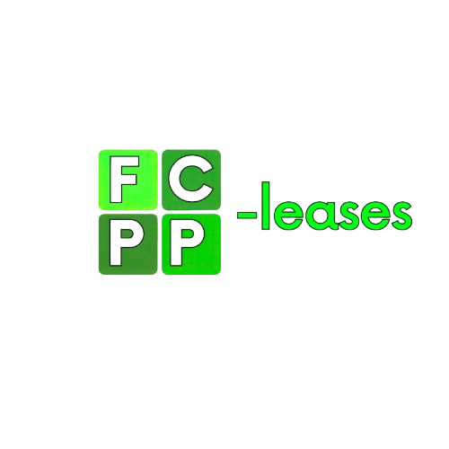
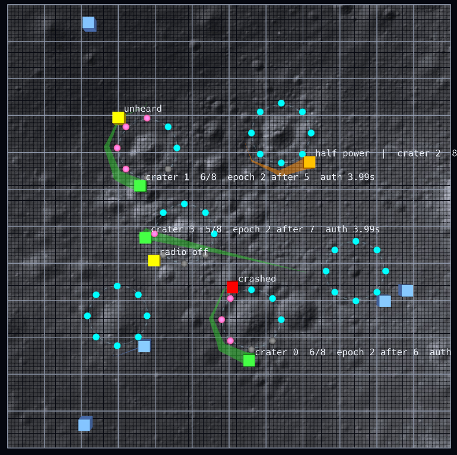

<p align="center"></p>

<p align="center">
  <a href="https://sposatomatiascarlos.github.io/fcpp-leases/"></a>
</p>

A header-only library for [FCPP](https://github.com/fcpp/fcpp). It makes sure a task is worked on by one device at a
time, gets completed once, and, if whoever is working on it fails, gets picked up by someone else from where it was left.

Whoever holds a task renews a lease in the field every round. If it stops, the lease runs out by itself, so nobody has
to detect the fault. The holder also keeps working only while its neighbours echo its renewals back, which means a
holder nobody can hear stops before anyone else takes over. The state of the task travels with the lease, and that is
where a successor resumes. No server, no synchronised clocks, no failure detector.

```cpp
#include "lib/leases.hpp"
using namespace fcpp::coordination::leases;

spawn(CALL, [&](my_job const& job) {
    return run_lease(CALL, job, config, on_event);   // every round, inside the process of the job
}, new_jobs);
```

## Try it

```
git clone --recursive https://github.com/SposatoMatiasCarlos/fcpp-leases.git
cd fcpp-leases
./make.sh gui run rovers
```

[`examples/rovers.cpp`](examples/rovers.cpp): rovers on the Moon read the seismic probes around six craters, one
rover per crater, with no base giving orders. Four of them break down while working (one crashes, one loses its radio,
one can no longer be heard, one runs at half power). The probes light up as their readings reach the shared checkpoint:
cyan if read by the first rover, pink if read by the one that took the crater over and resumed from there.

<p align="center"></p>

`make.sh` is the one of FCPP, which comes as the `fcpp` submodule (FCPP v0.9.2): `./make.sh run rovers` runs the
example without the GUI, `./make.sh test all` runs the tests. The prerequisites are those of FCPP: CMake 3.18 or newer, a
C++14 compiler, and for the GUI OpenGL (see the [FCPP README](https://github.com/fcpp/fcpp#readme)).

## Using it in your project

Put `fcpp-leases` in your FCPP project (without `--recursive`: it uses your FCPP) and, in your `CMakeLists.txt`:

```cmake
add_subdirectory(./fcpp-leases)
target_link_libraries(my_program PRIVATE fcpp::leases)
```

Then `#include "lib/leases.hpp"`. Without CMake, add the `fcpp-leases` folder to the include paths.

## Writing a job

The job is the only thing you write: what the work is, who is best for it, and one round of it. For instance, take 10
samples at a point, by exactly one device:

```cpp
struct sampling {
    int id;
    vec<2> point;

    bool operator==(sampling const& o) const { return id == o.id; }

    // how it travels and is hashed, field by field (FCPP would otherwise copy its bytes, padding included)
    template <typename S> S& serialize(S& s) { return s & id & point; }
    template <typename S> S& serialize(S& s) const { return s << id << point; }

    using progress_type = int;                  // the samples taken: where a successor resumes

    FUN int start(ARGS) const { CODE            // no samples yet
        return 0;
    }

    FUN real_t rank(ARGS) const { CODE          // lower is better: the closest device
        return distance(node.position(), point);
    }

    FUN int work(ARGS, int taken, step& s) const { CODE     // one round, only on the holder of the lease
        if (follow_target(CALL, point, 2, 1) > 1) return taken;    // still on its way
        if (++taken == 10) s.finish();
        return taken;
    }
};
```

The timing of the leases comes from the round period and the diameter of the network, in hops:

```cpp
lease_config config(1, 6);      // rounds of 1 s, up to 6 hops: ttl 15 s, settle 14 s, guard 0.5 s
config.stall_timeout = 10;      // optional: a live holder that makes no progress for 10 s is replaced
```

Then every device runs the jobs, each in its own process, as in the snippet at the top. The
[usage guide](https://sposatomatiascarlos.github.io/fcpp-leases/) has the rest: what `run_lease` returns, events, the
other fields of `lease_config`.

## Simulating faults

`lib/leases/sim/injector.hpp` is a fault plan: which device breaks down, how, and when.

```cpp
#include "lib/leases/sim/injector.hpp"

injector const plan = injector()
    .crash(4, 15)                               // device 4 stops for good at t = 15
    .add(7, 20, 50, fault::silent())            // device 7 neither sends nor receives during [20, 50)
    .add(5, 12, never, fault::mute())           // from t = 12 device 5 hears the others, but nobody hears it
    .add(9, 30, 40, fault::deaf())              // device 9 sends, but receives nothing during [30, 40)
    .add(1, 13, never, fault::degraded(0.5));   // from t = 13 device 1 works at half capability
```

It applies nothing: every round, first thing, each device calls `simulate_fault`, which returns the fault the plan
gives it now (and emits `fault_begin` and `fault_end` when it changes). What each fault means is up to the program:

```cpp
fault f = simulate_fault(CALL, plan, on_event);
switch (f.kind) {
    case fault_kind::crash:    stop(CALL); return;            // does nothing any more
    case fault_kind::degraded: slow_down(CALL, f.capability); break;
    case fault_kind::silence:  radio_off(CALL);               break;
    default:                   radio_on(CALL);                break;
}
```

Current limitation: a device has one fault at a time. Faults do not combine: where two windows of the same device
overlap, the last one added wins (a device cannot be, say, degraded and mute together).

## What's inside

| Path | |
|---|---|
| `lib/leases.hpp` | the whole library in one include |
| `lib/leases/model/` | the data: leases and their configuration, checkpoints, jobs, events, faults |
| `lib/leases/ownership/` | the lease rules (`lease_round`) |
| `lib/leases/run_lease.hpp` | `run_lease`: a job under its lease, checkpoints, takeovers |
| `lib/leases/sim/` | fault plan, for simulations and tests |
| `examples/rovers.cpp` | the example, with the GUI |
| `textures/` | the logo, a screenshot of the example, and its lunar surface (from an [LROC](https://commons.wikimedia.org/wiki/File:Secondaries_near_Mare_Moscoviense_(LROC717_-_M110980770R_thumb).png) photo by NASA/GSFC/Arizona State University, public domain) |
| `test/` | `ownership.cpp` checks the lease rules one by one, `recovery.cpp` runs whole networks with faults |
| `docs/` | the documentation, in English and Italian |

`bash docs/build.sh` builds the documentation with Doxygen into `docs/build/html`; it is also
[online](https://sposatomatiascarlos.github.io/fcpp-leases/).
